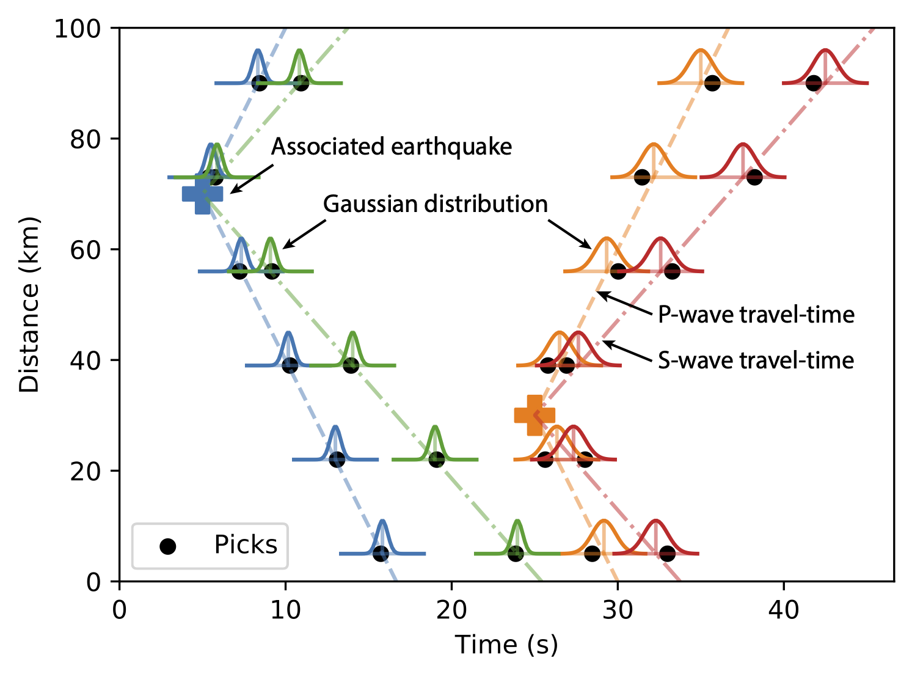
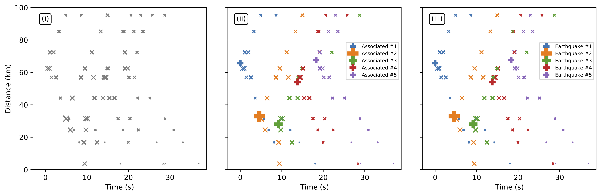
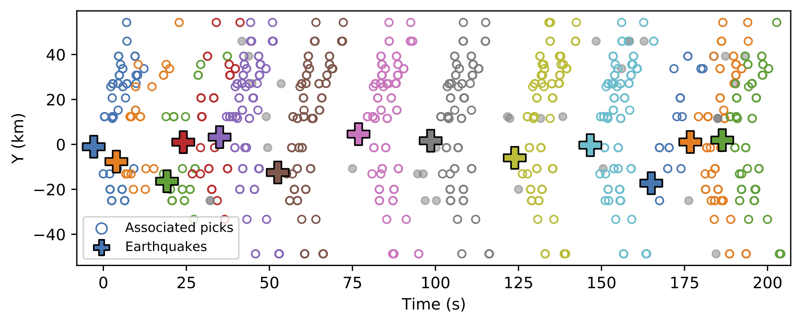

# [*GaMMA*: *Ga*ussian *M*ixture *M*odel *A*ssociator](https://ai4eps.github.io/GaMMA)

[](https://ai4eps.github.io/GaMMA)
[](https://pypi.org/project/gmma)

## 1. Install
```bash
pip install git+https://github.com/wayneweiqiang/GaMMA.git
```

The implementation is based on the [Gaussian mixture models](https://scikit-learn.org/stable/modules/mixture.html#gmm) in [scikit-learn](https://scikit-learn.org/stable/index.html)

## 2. Related papers
- Zhu, W., McBrearty, I. W., Mousavi, S. M., Ellsworth, W. L., & Beroza, G. C. (2022). Earthquake phase association using a Bayesian Gaussian mixture model. Journal of Geophysical Research: Solid Earth, 127(5), e2021JB023249.

**Generating automatic picks**:
- Zhu, W., & Beroza, G. C. (2019). PhaseNet: a deep-neural-network-based seismic arrival-time picking method. Geophysical Journal International, 216(1), 261-273.

**Adding 1D velocity model support**:
- Xi, Z., Wei, S. S., Zhu, W., Beroza, G. C., Jie, Y., & Saloor, N. (2024). Deep learning for deep earthquakes: insights from OBS observations of the Tonga subduction zone. Geophysical Journal International, 238(2), 1073-1088.
- Jie, Y., Wei, S. S., Zhu, W., Freymueller, J. T., & Elliott, J. (2025). Background Seismicity and Aftershocks of the 2020-2021 Large Earthquakes at the Alaska Peninsula Revealed by a Deep-learning-based Catalog. Authorea Preprints.



## 3. Usage

```python
from gamma.utils import association

config = {"xlim_km": (-50, 50), "ylim_km": (-50, 50), "zlim_km": (0, 30), "proj": proj}  # proj: a pyproj Proj
events, assignments = association(picks, stations, config, method="BGMM")
```

### Inputs (the same names as [ADLoc](https://github.com/AI4EPS/ADLoc))
- **picks**: station_id, phase_time, phase_type ("P" or "S"), phase_score, phase_amplitude (m/s). A pick without an amplitude (NaN, -1 or <= 0) is associated by its time alone.
- **stations**: station_id, longitude, latitude, z_km (positive down).
- **proj**: with a pyproj Proj, every station goes into that one frame. Without it, each segment of picks gets its own frame around its stations, so one run can cover any area.
- Names from before 1.8 still work, with one warning.

### Outputs
- **events**: time, longitude, latitude, depth_km (and x_km, y_km, z_km with proj), magnitude (NaN without amplitudes), sigma_time, sigma_amp, cov_time_amp, gamma_score, num_picks, num_p_picks, num_s_picks, event_index.
- **assignments**: (pick index, event_index, score) for each associated pick.

### Settings
- **method** (argument, default = "BGMM"): "BGMM" or "GMM".
- **xlim_km**, **ylim_km**, **zlim_km**: where events can be (km). **bfgs_bounds**, when given, overrides them.
- **use_amplitude** (default = True): amplitudes take part in the clustering.
- **vel** (default = {"P": 6.0, "S": 6.0 / 1.73}): uniform velocity (km/s).
- **eikonal** (optional): a 1D velocity model, read at absolute depth with one travel-time table per station depth:
  ```python
  {"vel": {"Z": [depths], "P": [p_velocities], "S": [s_velocities]}, "h": grid_spacing, "zlim_km": z_range}
  ```
  Set its zlim_km deeper than the events' (e.g. (0, 60)) so that first arrivals at far stations (Pn) are modelled.
- **segment** (default = "dbscan"): how picks are cut into segments before association: "dbscan", "link" (picks that one event could produce) or None.
  - **dbscan_eps** (default: from the station spacing): max time (s) between neighbouring picks.
  - **dbscan_min_samples** (default = 3): picks in a neighbourhood for a core point.
- **oversample_factor** (default = 5 for BGMM, 1 for GMM): initial events per segment = most picks at one station × this.
- **covariance_prior** (default = 5 × (1.5², 0.5²)) and **degrees_of_freedom_prior** (default = 5): the Wishart prior on each event's time (s²) and amplitude (log10²) spread. A larger time spread merges events; a smaller one splits them.
- **ncpu** (default: up to 32): worker processes.
- Filtering: each event is relocated on its own picks, picks beyond the residual limits are dropped, and the event is kept if what remains meets:
  - **min_picks** (default = 5): Minimum picks for associated earthquakes.
    - **min_p_picks**, **min_s_picks** (default = 0): Minimum P and S picks.
  - **min_score_sum** (default = 0.5 × min_picks): Minimum sum of the pick scores of an event.
    - **min_p_score_sum**, **min_s_score_sum** (default = 0.5): The same for its P picks and for its S picks.
  - **min_stations** (default = 0): Minimum stations.
  - **max_residual_time** (default = 2.0): Max phase time residual (s)
  - **max_residual_amplitude** (default = None, no limit): Max phase amplitude residual (log10 scale), with use_amplitude.
  - **min_station_support** (default = 0.3; 0 keeps every event): drops events whose nearest reliable stations did not pick them (picks that lined up by chance).

Speed is set by **dbscan_eps** and **oversample_factor**: larger values associate better and slower.

- Synthetic Example



- Example using [PhaseNet](https://wayneweiqiang.github.io/PhaseNet/) picks

See details in the [notebook](https://github.com/AI4EPS/GaMMA/blob/main/docs/example_phasenet.ipynb): [example_phasenet.ipynb](example_phasenet.ipynb)

- Example using [Seisbench](https://github.com/seisbench/seisbench)

See details in the [notebook](https://github.com/seisbench/seisbench/blob/main/examples/03c_catalog_seisbench_gamma.ipynb): [example_seisbench.ipynb](example_seisbench.ipynb)



More examples can be found in the earthquake detection workflow -- [QuakeFlow](https://ai4eps.github.io/QuakeFlow/)
